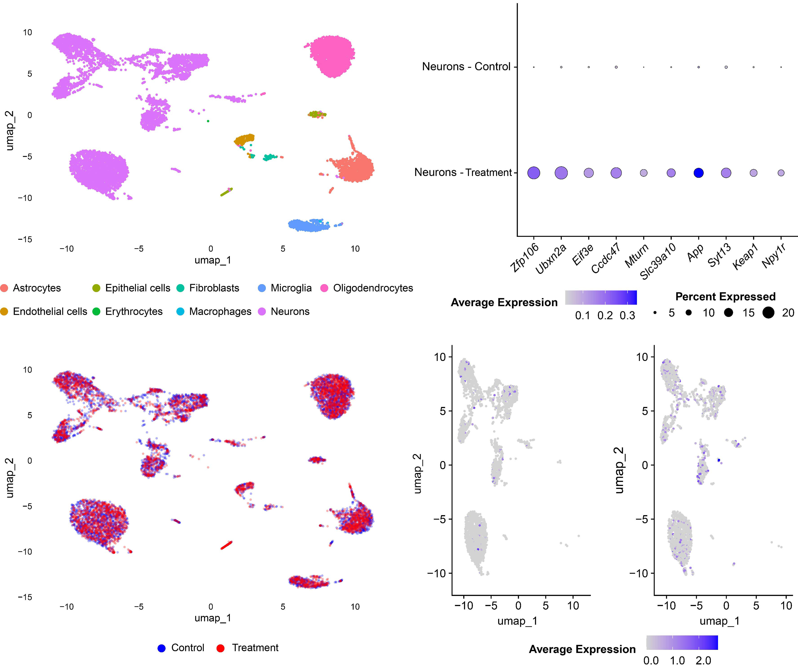

# single-cell-rnaseq
Single-cell RNA-seq analysis workflows in R using Seurat, SoupX, SingleR, and related tools.

## Overview
This repository contains a workflow for processing and analyzing 10x Genomics single-cell RNA-seq data from a Control and a Treatment sample. The analysis covers ambient RNA correction, clustering, cell type annotation, visualization, and differential expression testing in neurons.

## Methods
- Cell Ranger data import
- SoupX ambient RNA correction
- Seurat normalization, clustering, and UMAP
- SingleR cell type annotation (mouse reference from celldex)
- Differential expression analysis in neurons (Control vs Treatment)
- Visualization: UMAPs, dot plots, violin, feature, and box plots

## Requirements
R (4.3 or later) with these packages:

- **CRAN:** Seurat, SoupX, tidyverse, ggbreak, patchwork, cowplot, RColorBrewer, future, Matrix, hdf5r
- **Bioconductor:** SingleR, celldex, SummarizedExperiment

```r
install.packages(c("Seurat", "SoupX", "tidyverse", "ggbreak", "patchwork",
                   "cowplot", "RColorBrewer", "future", "Matrix", "hdf5r",
                   "BiocManager"))
BiocManager::install(c("SingleR", "celldex", "SummarizedExperiment"))
```

`celldex` downloads the reference dataset the first time it runs, so that step needs internet access.

## Input data
Cell Ranger `count` output for each sample, organized as:

```
<base_dir>/01_analysis/cellranger_count/
├── sample_control/
│   ├── filtered_feature_bc_matrix/
│   └── raw_feature_bc_matrix/
├── sample_treatment/
│   ├── filtered_feature_bc_matrix/
│   └── raw_feature_bc_matrix/
└── ref/
    └── <reference>_feature_bc_matrix.h5
```

The reference sample is used only in the initial clustering that SoupX needs, and is excluded from all downstream analyses. Raw data are not included in this repository.

## Usage
1. Set `base_dir` and `output_dir` in section 1 of `single_cell_rnaseq_workflow.R`.
2. Run the script:

```bash
Rscript single_cell_rnaseq_workflow.R
```

All figures and tables are written to `output_dir`.

## Outputs
- Cell type distribution plot
- UMAPs by cell type and by sample
- Neuron-only UMAP
- Neuronal DEG table (`filtered_deg_neurons.csv`)
- Dot plot of the top 10 neuronal DEGs
- App feature plots in neurons, by sample
- Violin, feature, and box plots of top markers
- Four-panel summary figure (`multipanel_figure.png`)

## Example Results


**(Top left)** UMAP of cells colored by SingleR cell type. **(Top right)** Dot plot of the top 10 differentially expressed genes in neurons; dot size is the percent of cells expressing the gene and color is average expression. **(Bottom left)** UMAP colored by sample (Control, Treatment). **(Bottom right)** App expression in neurons, Control (left) and Treatment (right).
